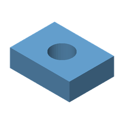
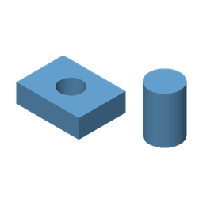

# STEP Preview

**Объёмные эскизы STP и STEP прямо в Проводнике Windows 11.**

Расширение читает геометрию CAD-модели и создаёт статическую изометрическую
миниатюру. Эскизы доступны в режимах **«Обычные значки»**, **«Крупные значки»**
и **«Огромные значки»**, когда Windows разрешает их показ.

Обработка выполняется локально: модели не отправляются в сеть. Для готовой
сборки не нужны установленная CAD-программа, отдельный Python или .NET —
Python и Open CASCADE входят в комплект. Программа открытия STP/STEP не меняется.

> **Готовится первый публичный релиз 1.0.0.** Базовый показ эскизов подтверждён
> пользователем на Windows 11. Параллельность проверена прямыми COM-тестами;
> такое же ускорение обычного просмотра папки пока не доказано.

<p>
  
  
</p>

*Изображения созданы рендерером из синтетических моделей тестов; это примеры
результата, а не скриншот интерфейса Проводника.*

## Возможности

- `.stp` и `.step`, STEP Part 21 с гранями, которые читает OCCT.
- Изометрическая камера, прозрачный фон, сглаживание и единый цвет деталей.
- Учёт размещения компонентов сборки, когда вся геометрия находится внутри STEP.
- Программная отрисовка без OpenGL, DirectX и окна CAD-программы.
- До двух отдельных процессов Python/OCCT на COM-хост.
- Установка для текущего пользователя и восстановление прежних thumbnail-регистраций.
- Сообщение об успехе или ошибке установки на русском и журнал диагностики.

Это **статические миниатюры файлов**. Интерактивная панель предварительного
просмотра, вращение модели и редактирование CAD в проект не входят.

## Установка

### Требования

Windows 11 **x64**, 64-битный Проводник и полностью распакованный ZIP сборки.
ARM64 и 32-битные файловые менеджеры не поддерживаются. Локальная тестовая
сборка занимает около 82 MiB в ZIP; после распаковки потребуется больше места.

### Готовая сборка

Если сопровождающий опубликовал проверенный бинарный ZIP, скачайте его из
раздела **Releases** этого репозитория. Архив **Code → Download ZIP** содержит
исходники: его сначала нужно собрать, DLL и runtime в Git не включены.

1. **Распакуйте архив целиком** в отдельную папку.
2. Запустите **`Install.cmd`** от обычного пользователя.
3. Дождитесь **«УСТАНОВКА УСПЕШНО ЗАВЕРШЕНА»** или **«ОШИБКА УСТАНОВКИ»**.
   Окно останется открытым до нажатия клавиши; при ошибке будет показана причина.
4. После обновления выйдите из учётной записи Windows и войдите снова,
   чтобы выгрузился предыдущий обработчик.
5. Выберите обычные, крупные или огромные значки в папке с моделями и нажмите F5.
6. В **Параметры Проводника → Вид** отключите флажок
   **«Всегда отображать значки, а не эскизы»**, если он установлен.

Установка размещает файлы в `%LOCALAPPDATA%\StepPreview` и регистрирует COM
в `HKCU`. Администраторские права не нужны. После установки исходную
распакованную папку можно удалить: расширение использует свою копию.

Журналы: **`%TEMP%\StepPreview-SetupLogs`**. Точный путь показан в конце.
Если запись журнала недоступна, установщик сообщит об этом отдельно.
Готовые сборки пока не подписаны цифровым сертификатом.

### Обновление и удаление

Для обновления запустите `Install.cmd` нового пакета поверх существующей версии.
Версии копируются в отдельные папки, поэтому занятая старая DLL не перезаписывается.

Удаление: **`Uninstall.cmd`** или **Параметры Windows → Приложения → STEP Preview**.
Если файлы ещё заняты, выйдите из учётной записи и повторите удаление.
Резервная копия регистраций остаётся в
`%LOCALAPPDATA%\StepPreview\registration.json`.

Проводник не завершается принудительно, системный кэш всех эскизов не очищается.
Прежний обработчик восстанавливается, если регистрация всё ещё принадлежит
STEP Preview: изменения, сделанные другим CAD-приложением позже, учитываются.

## Если эскизов нет или они появляются медленно

| Ситуация | Что проверить |
|---|---|
| Везде значки типа файла | Вид папки и флажок «Всегда отображать значки…» |
| Обновление не заметно | Выход и повторный вход в учётную запись |
| Одни STEP работают, другие нет | Наличие геометрии внутри самого файла |
| Эскизы пропали после смены CAD-программы | Повторная установка может восстановить регистрацию |
| Папка заполняется медленно | Импорт сложных моделей дорогой; Windows сама определяет параллельность запросов |
| Установка завершилась ошибкой | Сохраните причину и журнал; удалите персональные пути перед публикацией |

**Внешние STEP-ссылки не поддерживаются.** Если файл содержит только структуру
сборки и ссылки на соседние детали, экспортируйте всю геометрию в **один STEP**.

## Ограничения и производительность

| Параметр | Значение |
|---|---:|
| Входной файл | До 64 MiB |
| Изображение | До 1024 × 1024 px |
| Число треугольников | До 200 000 |
| Бюджет обработки, включая очередь worker | 20 с |
| Одновременные запросы на COM-хост | До 2 |
| Предел памяти | 1 GiB на worker, до 2 GiB на хост |
| Завершение по простою | 30 с |
| Замена worker | После 32 запросов |

При ошибке Windows может показать обычный значок. Первый запрос загружает Python
и CAD-ядро; следующие используют уже работающий процесс. Пул ускоряет несколько
файлов, но не импорт одной тяжёлой модели. Исходные цвета, материалы и PMI
не извлекаются. Размеры, в которых Windows показывает эскизы, определяет сама Windows.

В прямом COM-тесте 12 запросов заняли **15,9 с последовательно** и
**8,2 с с двумя клиентами**. Это локальный замер, не гарантия для Проводника.
Стандартная изолированная Shell-активация отдельного тестового CLSID завершилась
ошибкой регистрации; прямые COM-вызовы её не заменяют.

## Сборка из исходников

Нужны Windows x64, Windows PowerShell 5.1 или PowerShell 7, Python 3.14 x64
с `pip`, доступ к PyPI и python.org при первой сборке. Visual Studio не требуется.

```powershell
powershell -NoProfile -ExecutionPolicy Bypass -File .\scripts\build.ps1
```

Скрипт загружает Zig и зависимости в `.tools/`, собирает DLL, добавляет Python
Embedded и выполняет тесты. Глобальные пакеты Python не устанавливаются.
SHA256 архива Python проверяется; версии пакетов закреплены в
[`renderer/requirements.txt`](renderer/requirements.txt).

```text
artifacts/StepPreview-x64/       пакет с Install.cmd
artifacts/StepPreview-x64.zip    локальный архив сборки
```

Параметр `-SkipTests` предназначен для локальной упаковки. CI использует обычную
сборку с тестами. **Перед публичным бинарным релизом** проверьте
[лицензии зависимостей](THIRD_PARTY.md): OCP-wheel включает дополнительные DLL
со своими лицензиями, и аудит полного комплекта уведомлений пока не завершён.

Рендер файла без регистрации, из папки готового пакета:

```powershell
.\runtime\python.exe -I -B .\render_step.py `
  --input C:\Models\part.step --output C:\Models\part.png --size 256
```

### Проверки

Сборка выполняет 16 тестовых методов: геометрия, HBITMAP, прозрачность,
протокол, повторное использование процессов, сбои, тайм-ауты, очередь,
конкурирующие запросы и защита общего объекта. Тестовые модели генерируются
программно, чужие CAD-файлы не нужны. CI не регистрирует рабочий обработчик.

[`tests/`](tests) содержит тесты и эталонную отрисовку.
Полная проверка установки, отката регистраций и работы через стандартную
изоляцию Windows в Проводнике проводится отдельно от автоматических тестов.

## Устройство проекта

```text
Проводник → COM-хост Windows → StepThumbnail.dll
                                  ↓
                      пул Python/OCCT, до 2 процессов
                                  ↓
                      STEP → сетка → StepRaster.dll
                                  ↓
                            BGRA → HBITMAP
```

DLL реализует `IInitializeWithStream` и `IThumbnailProvider`. Модель и пиксели
передаются через pipe. Python, CLR и OCCT не загружаются внутрь COM-хоста;
временные модели не записываются. Worker ограничены Windows Job Object.
Системная изоляция сохраняется, `DisableProcessIsolation` не включается.

| Каталог | Содержимое |
|---|---|
| `src/` | COM, пул процессов, нативная отрисовка |
| `renderer/` | Чтение STEP, сетка и серверный протокол |
| `scripts/` | Установка, удаление и сборка |
| `tests/` | Синтетические модели и проверки |
| `docs/images/` | Публичные примеры эскизов |
| `licenses/` | Сохранённые тексты отдельных сторонних лицензий |

## Авторы и лицензия

Инициатор и сопровождающий — [vkoshkarov](https://github.com/vkoshkarov).
Первоначальная реализация подготовлена с помощью OpenAI Codex.

| Компонент | Авторы / проект | Лицензия |
|---|---|---|
| STEP Preview: C/Python-код, скрипты и тесты | vkoshkarov и участники STEP Preview | [MIT](LICENSE) |
| Open CASCADE Technology 7.9.3 | OPEN CASCADE SAS и участники OCCT | LGPL-2.1 с исключением OCCT |
| OCP / cadquery-ocp-novtk 7.9.3.1.1 | Bernhard Walter и участники CadQuery/OCP | Apache-2.0 |
| CPython 3.14.4 | Python Software Foundation и участники CPython | PSF License и включённые уведомления |
| NumPy 2.4.2 | NumPy Developers | BSD-3-Clause и включённые уведомления |
| Pillow 12.1.1 | Jeffrey A. Clark, Fredrik Lundh, Secret Labs AB и участники | MIT-CMU и включённые уведомления |
| Zig 0.14.1, инструмент сборки | Andrew Kelley и участники Zig | MIT и лицензии компонентов toolchain |

MIT распространяется на собственный код проекта; зависимости сохраняют свои
лицензии. Подробности: [THIRD_PARTY.md](THIRD_PARTY.md).

При разработке изучались примеры Microsoft Windows-classic-samples,
kavabunga6/Explorer3DPreview и chenxinxinpy/stp-thumbnail. Они указаны как источники
документации и архитектурных идей; их исходные файлы в проект не переносились.
Полная атрибуция: [AUTHORS.md](AUTHORS.md).

[Участие в разработке](CONTRIBUTING.md) ·
[Сообщения о безопасности](SECURITY.md)
